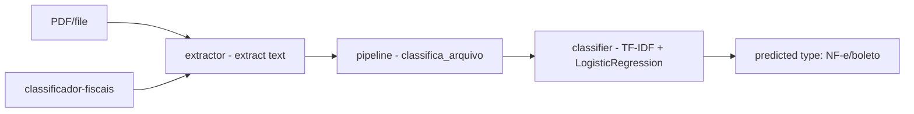

# classificador-documentos-fiscais

**English** · [Português (Brasil)](README.md)

[](#) [](#) [](#) [](#) [](LICENSE)

## What it is

**A Brazilian fiscal-document classifier**: it extracts text from a PDF/file (via pdfminer.six), trains a **text-classification model** (TF-IDF + Logistic Regression) on a sample dataset and predicts the document type (e.g. NF-e, boleto). It is an educational ML lab applied to documents.

## Status

An educational lab, working and tested (9 tests).

## Features

- **Text extraction** (`extractor.py`): `extrai_texto(path)` reads a PDF (pdfminer) or text file.
- **Classifier** (`classifier.py`): `ClassificadorDocumentosFiscais` with `treina`, `prediz`, `classes`; a TF-IDF + LogisticRegression pipeline (`random_state` configurable, default 42).
- **Evaluation**: accuracy and macro-F1.
- **Pipeline** (`pipeline.py`): `classifica_arquivo` — extracts, classifies and returns a `Classificacao`.
- **CLI**: `classificador-fiscais <file.pdf|txt>` prints the predicted type.

## Architecture

A `classificador_fiscais` package with `extractor` (extraction), `classifier` (TF-IDF+LR model) and `pipeline` (orchestration), wired to the CLI.



## Stack

- Python ≥ 3.10
- scikit-learn ≥ 1.3, pdfminer.six ≥ 2024
- pytest (dev)

## Repository layout

```
classificador-documentos-fiscais/
├── pyproject.toml · BRIEF.md
├── src/classificador_fiscais/
│   ├── extractor.py   # text extraction (pdfminer)
│   ├── classifier.py  # TF-IDF + LR model
│   ├── pipeline.py    # orchestration
│   └── __main__.py    # CLI
├── tests/             # 9 tests
└── LICENSE            # MIT
```

## Prerequisites and installation

```bash
pip install -e .
```

## How to run

```bash
classificador-fiscais nf-e.pdf
classificador-fiscais boleto.txt
```

## Tests and quality

```bash
PYTHONPATH=src python -m pytest tests/
# 9 passed
```

## Technical decisions and trade-offs

- **TF-IDF + Logistic Regression**: a classic, light text-classification model; interpretable and fast to train.
- **Embedded sample dataset**: runs and tests without external data; the trade-off is that production use requires real data.
- **Accuracy/F1-macro**: balanced multiclass classification metrics.

## Known limitations

- Trained on a small sample dataset (limited types: NF-e, boleto); not a full fiscal classifier.
- Text extraction depends on PDF quality/OCR (no built-in OCR).
- The trained model is not persisted (retrains on each run).

## Development process

An individual project by Kelvin Oliveira, built with orchestrated AI agents and reviewed by the author.

## License and author

MIT — Copyright (c) 2026 Kelvin Rebelo de Oliveira. Author: [Kelvin Oliveira](https://github.com/KelvinOliveiraCode) · [Portfolio](https://kelvinoliveiracode.github.io/portfolio/)
