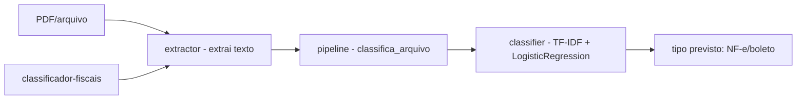

# classificador-documentos-fiscais

[English](README.en.md) · **Português (Brasil)**

[](#) [](#) [](#) [](#) [](LICENSE)

## O que é

**Classificador de documentos fiscais**: extrai texto de um PDF/arquivo (via pdfminer.six), treina um modelo de **classificação de texto** (TF-IDF + Regressão Logística) num dataset-exemplo e prevê o tipo do documento (ex.: NF-e, boleto). É um laboratório educacional de ML aplicado a documentos.

## Status

Laboratório educacional funcional e testado (9 testes).

## Funcionalidades

- **Extração de texto** (`extractor.py`): `extrai_texto(caminho)` lê PDF (pdfminer) ou arquivo de texto.
- **Classificador** (`classifier.py`): `ClassificadorDocumentosFiscais` com `treina`, `prediz`, `classes`; pipeline TF-IDF + LogisticRegression (`random_state` configurável, padrão 42).
- **Avaliação**: acurácia e F1-macro.
- **Pedido** (`pipeline.py`): `classifica_arquivo` — extrai, classifica e retorna `Classificacao`.
- **CLI**: `classificador-fiscais <arquivo.pdf|txt>` imprime o tipo previsto.

## Arquitetura

Pacote `classificador_fiscais` com `extractor` (extração), `classifier` (modelo TF-IDF+LR) e `pipeline` (orquestração), conectados ao CLI.



## Stack

- Python ≥ 3.10
- scikit-learn ≥ 1.3, pdfminer.six ≥ 2024
- pytest (dev)

## Estrutura do repositório

```
classificador-documentos-fiscais/
├── pyproject.toml · BRIEF.md
├── src/classificador_fiscais/
│   ├── extractor.py   # extração de texto (pdfminer)
│   ├── classifier.py  # modelo TF-IDF + LR
│   ├── pipeline.py    # orquestração
│   └── __main__.py    # CLI
├── tests/             # 9 testes
└── LICENSE            # MIT
```

## Pré-requisitos e instalação

```bash
pip install -e .
```

## Como executar

```bash
classificador-fiscais nf-e.pdf
classificador-fiscais boleto.txt
```

## Testes e qualidade

```bash
PYTHONPATH=src python -m pytest tests/
# 9 passed
```

## Decisões técnicas e trade-offs

- **TF-IDF + Regressão Logística**: modelo clássico e leve de classificação de texto; interpretável e rápido de treinar.
- **Dataset-exemplo embutido**: permite rodar e testar sem dados externos; em troca, o modelo precisa de dados reais para uso produtivo.
- **Accuracy/F1-macro**: métricas de classificação multiclasse equilibrada.

## Limitações conhecidas

- Treinado em dataset-exemplo pequeno (tipos limitados: NF-e, boleto); não é um classificador fiscal completo.
- Extração de texto depende da qualidade/OCR do PDF (sem OCR embutido).
- Sem persistência do modelo treinado (retreina ao rodar).

## Processo de desenvolvimento

Projeto individual de Kelvin Oliveira, construído com agentes de IA orquestrados e revisado pelo autor.

## Licença e autor

MIT — Copyright (c) 2026 Kelvin Rebelo de Oliveira. Autor: [Kelvin Oliveira](https://github.com/KelvinOliveiraCode) · [Portfólio](https://kelvinoliveiracode.github.io/portfolio/)
